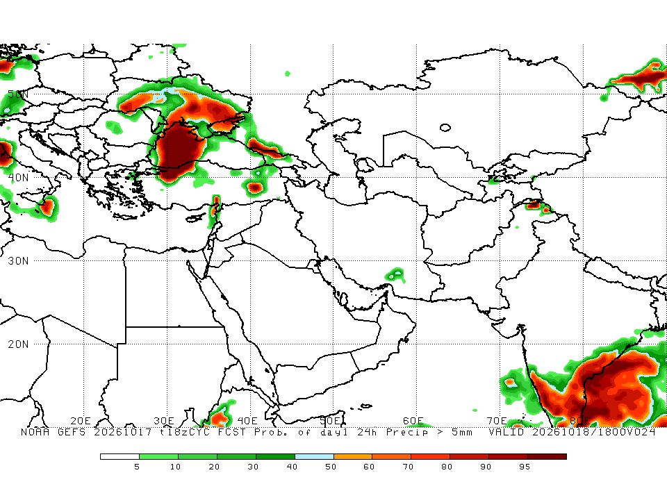
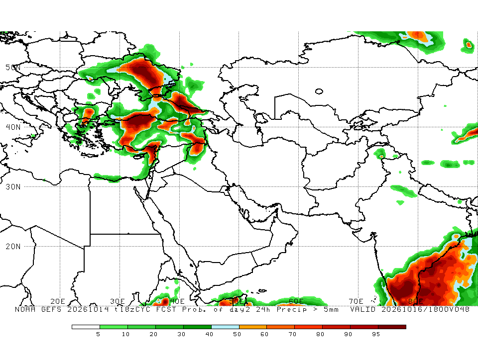
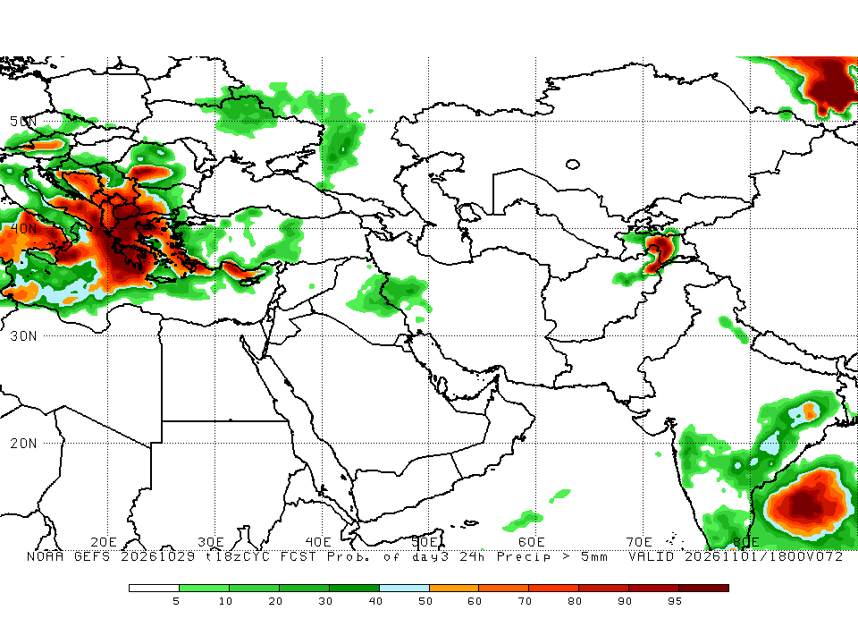

# ECMWF-FFPI-Kuwait
Automated ECMWF experimental flash flood potential maps for Kuwait

## GFS raw forecast guidance

`gfs_guidance.py` downloads a regional subset of NOAA GFS 0.25° GRIB2 from
NOMADS and plots simulated composite reflectivity (REFC), forecast rain rate
(PRATE), and 700 hPa relative humidity (RH) for forecast hour +6. The image
`output/GFS_GUIDANCE_KUWAIT_LATEST.png` shows the model run and valid time.
These are forecast fields for comparison with satellite observations; the
reflectivity is not measured radar data. A separate scheduled workflow updates
this image without changing the ECMWF FFPI calculation.
## GEFS CPC – 24h Precipitation Probability > 5 mm

### Day 1

### Day 2

### Day 3

